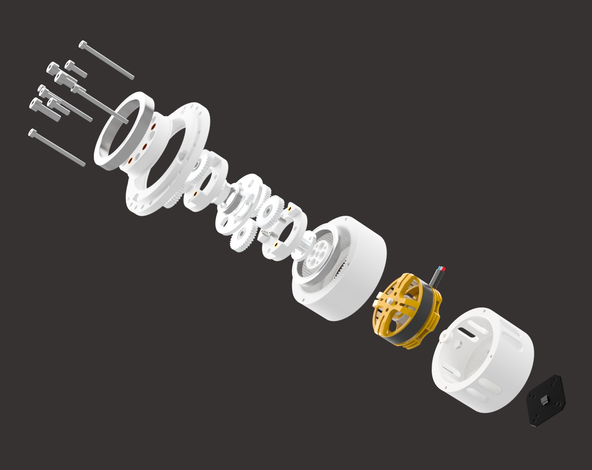

# Micro-Actuator
A medium-torque, open-source robotic actuator featuring a 7.385²:1 double stage planetary gearbox  paired with be4108 380kv and ESP32 SimpleFOC and external AS5047P magnetic encoder. 

